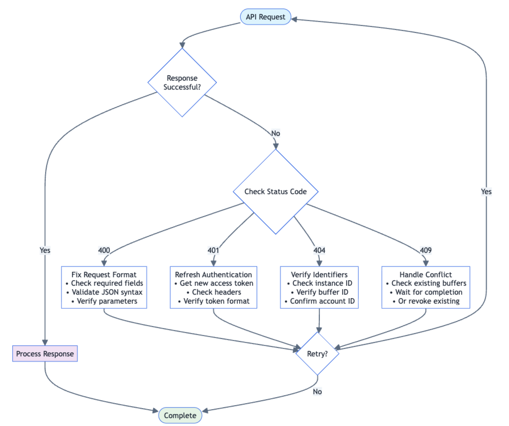

> ## Documentation Index
> Fetch the complete documentation index at: https://docs.lucidity.cloud/llms.txt
> Use this file to discover all available pages before exploring further.

# Temporary Buffer - Guide

Purpose: Allocate additional storage space on a cloud instance

| **ENDPOINT** | PATCH external/api/v1/autoscaler/instance/buffer/request |
| --- | --- |

**REQUEST BODY**

| **PARAMETER** | **TYPE** | **DESCRIPTION** |
| --- | --- | --- |
| instanceIdentifier.cloudProviderAccountId | string | Identifies the specific cloud account: - Azure ➜ Subscription ID - AWS ➜ Account ID - GCP ➜ Project ID |
| instanceIdentifier.cloudProvider | string (AWS \| AZURE \| GCP) | Identifies the cloud service provider (CSP). |
| instanceIdentifier.instanceId | string | The ID of the specific instance (or name in Azure) to scale. |
| instanceIdentifier.resourceGroup | string | The resource group where the instance resides (Azure only). |
| requestBufferSizeInGiB | long | The desired size of the temporary buffer (in GiB). |
| requestId | string | A unique, client-generated ID to ensure idempotency and prevent duplicate processing. If absent, the request is treated as new. |

### Example Request (AWS):

```json
{
    "instanceIdentifier": {
        "cloudProviderAccountId": "123456789012",
        "cloudProvider": "AWS",
        "instanceId": "i-0abcd1234efgh5678"
    },
    "requestBufferSizeInGiB": 50,
    "requestId": "maintenance-2024-001"
}
```

### Example Request (Azure):

```json
{
    "instanceIdentifier": {
        "cloudProviderAccountId": "a1b2c3d4-5678-90ef-gh12-3456ijklmnop",
        "cloudProvider": "AZURE",
        "instanceId": "my-vm-instance",
        "resourceGroup": "my-resource-group"
    },
    "requestBufferSizeInGiB": 100,
    "requestId": "req-azure-001"
}
```

### Example Request (GCP):

```json
{
  "instanceIdentifier": {
    "cloudProviderAccountId": "my-gcp-project-id",
    "cloudProvider": "GCP",
    "instanceId": "gcp-instance-12345"
  },
  "requestBufferSizeInGiB": 75,
  "requestId": "req-gcp-001"
}
```

Success Response (200):

```json
{
  "bufferId": "buf-abc123def456"
}
```

Error Responses:

- 409 Conflict: Another buffer is active on this instance
- 400 Bad Request: Invalid input parameters
- 404 Not Found: Instance not found or not managed by Lucidity
- 401 Unauthorized: Invalid or expired access token

## 2. Check Buffer Status

Purpose: Monitor buffer provisioning progress

| ENDPOINTS | GET external/api/v1/autoscaler/instances/buffer/{{bufferId}}/status |
| --- | --- |

### REQUEST BODY

| PARAMETER | TYPE | DESCRIPTION |
| --- | --- | --- |
| bufferId | string | The ID of the buffer returned from the request step. |

#### Success Response (200):

```json

{
  "instanceId": "i-0abcd1234efgh5678",
  "status": "ACTIVE",
  "currentFreeSpaceInGiB": 75,
  "bufferId": "buf-abc123def456",
  "failureReason": null
}
```

#### Status Values:

- PROVISIONING: Buffer is being created
- ACTIVE: Buffer is ready for use
- REVOKED: Buffer has been removed
- FAILED: Operation failed (see failureReason)

### 3. Revoke Buffer

Purpose: Remove buffer and return instance to original scaling policy

| **ENDPOINTS** | POST external/api/v1/autoscaler/instances/buffer/{{bufferId}}/revoke |
| --- | --- |

#### REQUEST BODY

| **PARAMETER** | **TYPE** | **DESCRIPTION** |
| --- | --- | --- |
| bufferId | string | The ID of the buffer returned from the request step. |

#### Request Body:

JSON

```json

{
  "bufferId": "buf-abc123def456"
}
```

#### Success Response (200):

JSON

```json

{
  "message": "Buffer revoked successfully"
}
```

# **Troubleshooting**

### Error Handling Strategy

**Error Handling & Recovery:** This flowchart shows how to handle common error scenarios with proper retry logic and recovery strategies.



This comprehensive flowchart shows how to handle all common error scenarios with proper retry logic and recovery strategies.

### Common Issues and Solutions

**1. Authentication Problems**

**Issue:** 401 Unauthorized errors.

**Causes & Solutions:**

- **Expired access token:** Access tokens expire after 15 minutes. Get a new one using your refresh token.
- **Invalid refresh token:** Contact CS team for a new refresh token.
- **Missing headers:** Ensure all required headers are included.
- **Wrong header values:** Verify `X-Authtype` is set to `lucidity_access_token`.

**2. Buffer Request Issues**

**Issue:** 409 Conflict — Another Buffer Request is active.

**Solution:** Only one buffer can be active per instance. Check existing buffers or wait for completion.

**Issue:** 404 Not Found — Instance not found.

**Causes:**

- Instance ID is incorrect.
- Instance is not managed by Lucidity.
- Wrong cloud provider specified.

**Debug Steps:**

1. Verify instance ID in your cloud console.
2. Confirm instance is visible in Lucidity dashboard.
3. Double-check cloud provider and account ID.

**3. Buffer Status Issues**

**Issue:** Buffer stuck in `PROVISIONING` status.

**Causes:**

- Cloud provider rate limits.
- Network connectivity issues.

**Actions:**

1. Wait before polling status again.
2. Contact Lucidity support if stuck beyond 30 minutes.

---

# **Best Practices**

### Security

- **Never log or commit API tokens** to version control.
- **Use secure credential storage** (vaults, secret managers).
- **Rotate refresh tokens regularly** (before expiry).
- **Monitor token usage** for unauthorized access.
- **Use HTTPS only** for all API communications.

### Performance & Reliability

- **Use request IDs** to prevent duplicate operations.
- **Respect rate limits:** Maximum 50 requests per minute.
- **Set appropriate timeouts** (5-10 seconds for API calls).

### Cost Optimization

- **Always revoke buffers** when operations complete.
- **Use automation** to prevent human error in cleanup.

### Operational Excellence

- **Use descriptive request IDs** for easier tracking.
- **Log all API operations** for audit trails.
- **Test in non-production** environments first.

---

# **FAQ**

### Troubleshooting Questions

**Q: What if buffer provisioning fails?**

**A:** Check the `failureReason` in the status response.

**Q: Can I cancel a buffer request?**

**A:** Once requested, you must wait for completion or failure. Then revoke if successful.


---

---
title: "Request a Temporary Buffer for an Instance API - Reference"
slug: "request-a-temporary-buffer-for-an-instance"
updated: 2026-02-13T04:04:04Z
published: 2026-02-13T04:04:04Z
canonical: "docs.lucidity.cloud/request-a-temporary-buffer-for-an-instance"
---

> ## Documentation Index
> Fetch the complete documentation index at: https://docs.lucidity.cloud/llms.txt
> Use this file to discover all available pages before exploring further.

# Request a Temporary Buffer for an Instance API - Reference

Patch/external/api/v1/autoscaler/instance/buffer/request

Allocates additional temporary storage (buffer) on a Lucidity-managed instance. Only one buffer can be active per instance at a time.

SecurityAPI Key: LucidityAccessTokenHeader parameter nameAuthorization

Short-lived Lucidity access token obtained via the refresh endpoint. Must be used together with X-Authtype: lucidity_access_token.

Header parametersX-AuthtypestringRequired

Specifies the type of authentication being used.

Valid values[
  "lucidity_access_token"
]

Body parameters<select class='api-response-data' aria-label='Media type'><option value='bd47bb62-e94a-4623-918b-888bb0e5ee67'>application/json</option>
</select><select class='select-example' aria-label='Media type'><option value='b7e46a62-c383-4799-9947-e6130ff81a1c'>awsExample</option>
<option value='59c6120e-ed54-4e0f-a837-14ff7c21c62d'>azureExample</option>
<option value='8aba75aa-94a4-4292-82e4-6708be88a8a4'>gcpExample</option>
</select>awsExample

AWS instance buffer request

```json
{
  "instanceIdentifier": {
    "cloudProviderAccountId": "123456789012",
    "cloudProvider": "AWS",
    "instanceId": "i-0abcd1234efgh5678"
  },
  "requestBufferSizeInGiB": 50,
  "requestId": "maintenance-2024-001"
}
```

azureExample

Azure instance buffer request

```json
{
  "instanceIdentifier": {
    "cloudProviderAccountId": "a1b2c3d4-5678-90ef-gh12-3456ijklmnop",
    "cloudProvider": "AZURE",
    "instanceId": "my-vm-instance",
    "resourceGroup": "my-resource-group"
  },
  "requestBufferSizeInGiB": 100,
  "requestId": "req-azure-001"
}
```

gcpExample

GCP instance buffer request

```json
{
  "instanceIdentifier": {
    "cloudProviderAccountId": "my-gcp-project-id",
    "cloudProvider": "GCP",
    "instanceId": "gcp-instance-12345"
  },
  "requestBufferSizeInGiB": 75,
  "requestId": "req-gcp-001"
}
```

Expand Allobject  instanceIdentifierobject (InstanceIdentifier)  RequiredcloudProviderAccountIdstring    Required

Identifies the specific cloud account: - Azure → Subscription ID - AWS → Account ID - GCP → Project ID

cloudProviderstring    Required

Cloud service provider.

Valid values[
  "AWS",
  "AZURE",
  "GCP"
]
instanceIdstring    Required

The ID of the specific instance to scale. In Azure, this may be the instance name.

resourceGroupstring   | null  

Resource group where the instance resides (Azure only).

requestBufferSizeInGiBinteger  (int64)    Required

Desired size of the temporary buffer (GiB).

Example50
requestIdstring    

Client-generated unique ID for idempotency and deduplication. If absent, the request is treated as new.

Examplemaintenance-2024-001

Responses200

Buffer successfully created.

<select class='api-response-data' aria-label='Media type'><option value='54ce3916-8cf2-4bbb-95c6-88fafb03d3e7'>application/json</option>
</select>object  bufferIdstring    

Unique identifier for the created buffer.

Examplebuf-abc123def456

400

Invalid input parameters.

<select class='api-response-data' aria-label='Media type'><option value='4a4ab41c-17f1-4ce7-a7a7-3e334435deec'>application/json</option>
</select>Expand Allobject  codestring    

Application-specific error code.

messagestring    

Human-readable description of the error.

detailsobject  

Optional structured error details.

401

Invalid or expired access token.

<select class='api-response-data' aria-label='Media type'><option value='72750dd5-14b8-4e75-aab6-8960e57ac7c0'>application/json</option>
</select>Expand Allobject  codestring    

Application-specific error code.

messagestring    

Human-readable description of the error.

detailsobject  

Optional structured error details.

404

Instance not found or not managed by Lucidity.

<select class='api-response-data' aria-label='Media type'><option value='754454e2-38b6-420c-b591-3eae15ac9d08'>application/json</option>
</select>Expand Allobject  codestring    

Application-specific error code.

messagestring    

Human-readable description of the error.

detailsobject  

Optional structured error details.

409

Another buffer is already active on this instance.

<select class='api-response-data' aria-label='Media type'><option value='8003d6e7-dbe7-469f-8e6d-dd0c0e3ce970'>application/json</option>
</select>Expand Allobject  codestring    

Application-specific error code.

messagestring    

Human-readable description of the error.

detailsobject  

Optional structured error details.


---

---
title: "Get the Status of a Buffer API - Reference"
slug: "get-the-status-of-a-buffer"
updated: 2026-02-13T04:04:10Z
published: 2026-02-13T04:04:10Z
canonical: "docs.lucidity.cloud/get-the-status-of-a-buffer"
---

> ## Documentation Index
> Fetch the complete documentation index at: https://docs.lucidity.cloud/llms.txt
> Use this file to discover all available pages before exploring further.

# Get the Status of a Buffer API - Reference

Get/external/api/v1/autoscaler/instances/buffer/{bufferId}/status

Returns the current status and free space of a previously requested buffer.

SecurityAPI Key: LucidityAccessTokenHeader parameter nameAuthorization

Short-lived Lucidity access token obtained via the refresh endpoint. Must be used together with X-Authtype: lucidity_access_token.

Header parametersX-AuthtypestringRequired

Specifies the type of authentication being used.

Valid values[
  "lucidity_access_token"
]

Path parametersbufferIdstringRequired

ID of the buffer returned from the request step.

Responses200

Buffer status successfully retrieved.

<select class='api-response-data' aria-label='Media type'><option value='1088c189-fe7b-4229-afb0-493835a91926'>application/json</option>
</select>object  instanceIdstring    

Cloud provider instance ID associated with the buffer.

Examplei-0abcd1234efgh5678
statusstring    

Current status of the buffer.

Valid values[
  "PROVISIONING",
  "ACTIVE",
  "REVOKED",
  "FAILED"
]
currentFreeSpaceInGiBinteger  (int64)    

Current free space in the buffer (GiB).

Example75
bufferIdstring    

Buffer identifier.

Examplebuf-abc123def456
failureReasonstring   | null  

Reason for failure when status is FAILED.

401

Invalid or expired access token.

<select class='api-response-data' aria-label='Media type'><option value='39d9f5e9-0d5a-4050-8dd2-ace3d965a93d'>application/json</option>
</select>Expand Allobject  codestring    

Application-specific error code.

messagestring    

Human-readable description of the error.

detailsobject  

Optional structured error details.

404

Buffer not found.

<select class='api-response-data' aria-label='Media type'><option value='57649c37-c989-496f-8dd3-732896d9db0f'>application/json</option>
</select>Expand Allobject  codestring    

Application-specific error code.

messagestring    

Human-readable description of the error.

detailsobject  

Optional structured error details.


---


---
title: "Revoke a Buffer and Restore Original Configuration API - Reference"
slug: "revoke-a-buffer-and-restore-original-configuration"
updated: 2026-02-13T04:04:15Z
published: 2026-02-13T04:04:15Z
canonical: "docs.lucidity.cloud/revoke-a-buffer-and-restore-original-configuration"
---

> ## Documentation Index
> Fetch the complete documentation index at: https://docs.lucidity.cloud/llms.txt
> Use this file to discover all available pages before exploring further.

# Revoke a Buffer and Restore Original Configuration API - Reference

Post/external/api/v1/autoscaler/instances/buffer/{bufferId}/revoke

Removes the temporary buffer and returns the instance to its original scaling policy. Buffers continue to incur cloud storage costs until revoked.

SecurityAPI Key: LucidityAccessTokenHeader parameter nameAuthorization

Short-lived Lucidity access token obtained via the refresh endpoint. Must be used together with X-Authtype: lucidity_access_token.

Header parametersX-AuthtypestringRequired

Specifies the type of authentication being used.

Valid values[
  "lucidity_access_token"
]

Path parametersbufferIdstringRequired

ID of the buffer to revoke.

Body parameters<select class='api-response-data' aria-label='Media type'><option value='53a9e9f8-aad5-4efb-878a-1d2ce37f6d83'>application/json</option>
</select>

```json
{
  "bufferId": "buf-abc123def456"
}
```

object  bufferIdstring    Required

ID of the buffer to revoke.

Examplebuf-abc123def456

Responses200

Buffer successfully revoked.

<select class='api-response-data' aria-label='Media type'><option value='31186318-06a7-4c9f-ba60-8bddacb17a67'>application/json</option>
</select>object  messagestring    ExampleBuffer revoked successfully

401

Invalid or expired access token.

<select class='api-response-data' aria-label='Media type'><option value='8b6c06e8-5535-4dc8-8afa-df0886ab9e2e'>application/json</option>
</select>Expand Allobject  codestring    

Application-specific error code.

messagestring    

Human-readable description of the error.

detailsobject  

Optional structured error details.

404

Buffer not found.

<select class='api-response-data' aria-label='Media type'><option value='59fad04f-b37c-4846-abf2-892ab6eec389'>application/json</option>
</select>Expand Allobject  codestring    

Application-specific error code.

messagestring    

Human-readable description of the error.

detailsobject  

Optional structured error details.
